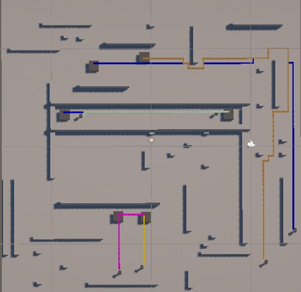

# Multi-Robot Path Planning Simulation

## Project Overview

This project develops a multi-robot path-planning simulation in Unity to evaluate different Multi-Agent Path Finding (MAPF) algorithms in a shared environment.

The simulation focuses on path generation, multi-robot conflict detection and resolution, and performance evaluation under controlled conditions.

The project is part of a Final Year Engineering Project investigating multi-robot coordination for low-cost robotic fleets.

## Technologies Used

- Unity 3D
- C#
- Grid-based path planning
- Multi-Agent Path Finding (MAPF)
- Multithreading using C# Tasks

## Path Planning Algorithms

### 1. Improved A* with Detouring

Based on the Improved A* and detouring approach proposed by Hu, He and Shen (2023).

The implementation consists of:

- Improved A* path generation
- Path Expert Database containing alternative paths
- Mark states for exploring alternative equal-f-cost nodes
- Conflict evaluation between robot paths
- Select/Replace procedure to reduce predicted conflicts

Unlike constraint-based approaches, this algorithm attempts to minimise conflicts by selecting alternative paths rather than guaranteeing a conflict-free solution.

### 2. Parallel Conflict-Based Search (PCBS) with Space-Time A*

The implementation combines Space-Time A* (STA*) with Conflict-Based Search (CBS).

Key features include:

- Space-Time A* path generation with movement and waiting actions
- Vertex and edge conflict detection
- Constraint Tree (CT) generation and expansion
- Vertex and edge constraints for affected robots
- Replanning using STA*
- Lowest-cost CT node selection
- Parallel low-level replanning using `Task.Run()`
- Sequential CBS mode for comparison

The high-level CBS process manages the Constraint Tree, while independent low-level STA* replanning tasks can execute concurrently on worker threads.

### 3. MAPF-LNS2

MAPF-LNS2 is an additional algorithm selected for comparison, using:

- Safe Interval Path Planning (SIPP)
- Safe Interval Path Planning with Soft Constraints (SIPPS)
- Prioritised Planning
- Neighbourhood selection
- Adaptive Large Neighbourhood Search (ALNS)
- Iterative path repair

*Implementation and experimental comparison are not yet documented in the results below.*

## Simulation Environment

The Unity simulation uses a grid-based environment with the following configuration:

| Parameter | Configuration |
|---|---|
| Simulation platform | Unity 3D |
| Grid cell size | 0.5 m × 0.5 m |
| Movement directions | 4-directional |
| Path heuristic | Manhattan distance |
| Initial robot count | 6 |
| Obstacles | Static |
| Robot representation | Single grid node |
| Goal occupancy | Robots remain at their destinations |
| Time representation | Discrete timesteps for STA* |

STA* uses a shared base timestep and calculates movement duration according to robot speed and grid-cell distance.

The simulation assumes ideal localisation, accurate movement execution, and no communication or motor-response delays.

## Main Unity Scripts

| Script | Purpose |
|---|---|
| `Node.cs` | Represents grid nodes |
| `PathGrid.cs` | Generates the grid and identifies neighbours |
| `AStar.cs` | Implements standard A* pathfinding |
| `ImprovedAStar.cs` | Generates alternative paths for the Path Expert Database |
| `SpaceTimeAStar.cs` | Implements time-dependent path planning and constrained replanning |
| `CBSController.cs` | Manages CBS/PCBS search and conflict resolution |
| `CBSNode.cs` | Stores CT constraints, paths and costs |
| `CBSConflict.cs` | Represents vertex and edge conflicts |
| `RobotMovement.cs` | Controls robot movement |
| `RobotPath.cs` | Stores and visualises robot routes |
| `SimulationMetrics.cs` | Records simulation performance |

## Performance Metrics

The algorithms are evaluated using:

- **Makespan:** Time required for the final robot to reach its destination.
- **Average Travel Distance:** Average distance travelled by the robots.
- **Average Travel Time:** Average time required to reach assigned destinations.
- **Collision Count:** Number of collisions detected during simulation.
- **Computation Time:** Total measured path-planning search work.

For PCBS, the reported search work includes initial STA* planning, main-thread CBS processing, and the sum of parallel STA* worker durations. This is different from wall-clock execution latency.

## Screenshots

### Improved A* with Detouring

### PCBS + Space-Time A*

## Initial Results

Preliminary results from a six-robot simulation are shown below.

| Metric | Improved A* + Detouring | PCBS + STA* |
|---|---:|---:|
| Robots completed | 6/6 | 6/6 |
| Average travel distance (m) | 21.333 | 21.333 |
| Average travel time (s) | 21.333 | 21.333 |
| Makespan (s) | 41.500 | 41.500 |
| Collision count | 2 | 0 |
| Total search work (ms) | 600.169 | 308.645 |

Both algorithms produced the same average travel distance, average travel time and makespan in this scenario.

However, Improved A* retained two collisions after the Select/Replace procedure, while PCBS + STA* generated a conflict-free solution.

PCBS + STA* also recorded lower total search work in the tested scenario. Further experiments are required to evaluate performance under different robot densities and more congested environments.

## My Contributions

My work focuses on implementing and evaluating multi-robot path-planning algorithms in Unity, including:

- Developing and configuring the grid-based simulation environment
- Implementing Improved A* with a Path Expert Database and Select/Replace procedure
- Implementing CBS/PCBS with Space-Time A*
- Implementing vertex and edge conflict detection and constraint-based replanning
- Integrating parallel low-level STA* replanning
- Implementing simulation metrics and collecting experimental results
- Comparing path efficiency, collisions, makespan and computation time

## How to Run

1. Clone or download this repository.
2. Open the Unity project using Unity Hub and the compatible editor version specified in `ProjectSettings/ProjectVersion.txt`.
3. Open the relevant simulation scene.
4. Check the robot, target, grid and planner references in the Inspector.
5. For PCBS experiments, enable `Use Parallel Low Level Replanning` on the `CBSController` component.
6. Press **Play** to run the simulation.
7. View paths in the Unity Scene view and check the Console for planning information and results.

## Limitations

- Robot movements are assumed to follow planned trajectories accurately.
- Robots are represented by single grid nodes.
- Obstacles are static.
- Communication delays and localisation uncertainty are excluded.
- Results are preliminary and do not establish large-scale scalability.
- Unity computation times do not represent performance on physical robot hardware.

## Project Status

**University Final Year Engineering Project — 2026**

Completed work includes the Unity simulation environment, Improved A* with detouring, PCBS with STA*, and initial six-robot performance evaluation.

Future work includes further MAPF comparisons, larger simulation scenarios, integration with continuous-space collision avoidance, and physical robot testing.

## References

- Hu, E., He, J., and Shen, S. (2023). *A Dynamic Integrated Scheduling Method Based on Hierarchical Planning for Heterogeneous AGV Fleets in Warehouses*. Frontiers in Neurorobotics.
- Lin, Z., Ding, P., and Li, J. (2021). *Task Scheduling and Path Planning of Multiple AGVs via Cloud and Edge Computing*. IEEE ICNSC.
- Li, J., Chen, Z., Harabor, D., Stuckey, P. J., and Koenig, S. (2022). *MAPF-LNS2: Fast Repairing for Multi-Agent Path Finding via Large Neighborhood Search*. AAAI.